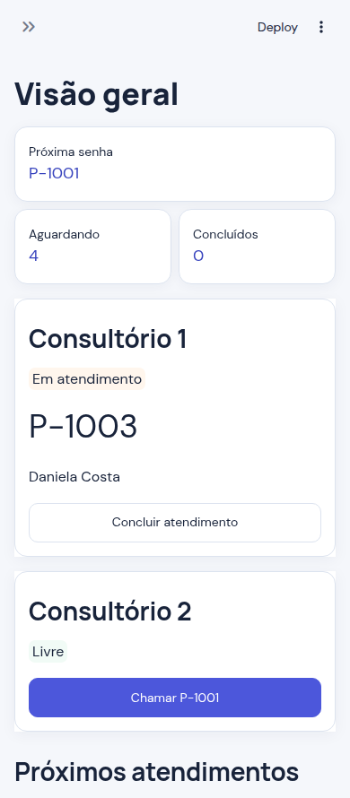
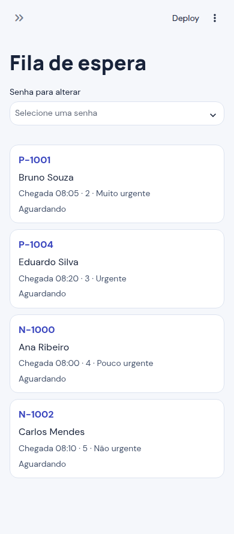

# SIGAE

Trabalho final de Estrutura de Dados Avançados da Universidade de Vassouras.

O SIGAE simula a fila de um pronto-atendimento com dois consultórios e uma fila compartilhada. A interface web usa Streamlit 1.67.0 com persistência em SQLite. O terminal oferece uma demonstração independente que roda em memória. Use dados fictícios nas duas interfaces.

## Como executar

Instale o [Python 3.11 ou superior](https://www.python.org/downloads/). Na raiz do projeto, crie um ambiente virtual e instale as dependências.

**Linux ou macOS**

```bash
python3 -m venv .venv
.venv/bin/python -m pip install -r requirements.txt
.venv/bin/python -m streamlit run app.py
```

**Windows PowerShell**

```powershell
py -m venv .venv
.\.venv\Scripts\python.exe -m pip install -r requirements.txt
.\.venv\Scripts\python.exe -m streamlit run app.py
```

Abra o endereço exibido no terminal, geralmente `http://localhost:8501`. A primeira execução cria uma base vazia. Para experimentar com cinco fichas fictícias, vá a **Estruturas**, escolha **Padrão** ou **Colisões na hash** e selecione **Carregar exemplo**. A opção aparece apenas enquanto a base está vazia.

## Interface web

| Tela | Como usar |
| --- | --- |
| **Visão geral** | Veja a próxima senha, o total aguardando, os atendimentos concluídos e as cinco primeiras fichas na ordem de chamada. Os botões dos consultórios também aparecem nesse painel. |
| **Consultórios** | Um consultório livre pode chamar a senha exibida no botão. Um consultório ocupado exibe a senha e o nome do paciente até o operador selecionar **Concluir atendimento**. |
| **Novo paciente** | Informe um nome de 2 a 90 caracteres, o horário de chegada e escolha **Normal** ou **Prioridade**. Deixe o número manual vazio para gerar a ficha automaticamente a partir de 1000, pulando números já usados. A confirmação mostra a senha gerada. Depois de gravar, o formulário fica pronto para outro cadastro. Se houver erro, os dados digitados continuam disponíveis para correção. |
| **Fila de espera** | Veja as fichas na ordem de chamada. Selecione uma senha para reclassificar ou cancelar. O formulário começa com a classificação atual; o cancelamento exige marcar a confirmação da senha selecionada. As duas ações estão disponíveis enquanto a ficha aguarda. |
| **Pacientes** | Consulte pela senha completa, como `P-1003` ou `N-1000`. Com a busca vazia, a tela lista todas as fichas por número. |
| **Chegadas** | Veja os pacientes que ainda aguardam, ordenados pelo horário informado e, em caso de empate, pelo número da ficha. |
| **Histórico** | Consulte os atendimentos concluídos e cancelados, a partir do encerramento mais recente. |
| **Estruturas** | Inspecione a árvore rubro-negra, os níveis do heap e os buckets da hash. A tela confirma a validação dos índices antes de mostrá-los. |

### Uso no celular

Abra **Navegação** pelo botão no canto superior esquerdo. Em telas de até 640 px, a próxima senha ocupa toda a largura, os dois totais ficam lado a lado e os consultórios são empilhados. Os botões de ação têm pelo menos 44 px de altura. Fila, chegadas, histórico e consulta exibem cartões com as informações de cada ficha, legíveis sem rolagem horizontal. Em telas maiores, essas listas aparecem em tabelas. Listas com mais de dez fichas têm seletor de página.

Capturas do painel e da fila em 390 px, com dados fictícios.

<p>
  
  
</p>

## Senhas e ordem de chamada

| Classificação | Senha | Ordem de chamada |
| --- | --- | --- |
| Prioridade | `P-<id>` | Primeiro grupo |
| Normal | `N-<id>` | Segundo grupo |

Toda ficha **Prioridade** é chamada antes das fichas **Normal**. Dentro de cada classificação, chama-se primeiro pelo horário de chegada e depois pelo menor número da ficha. Por exemplo, `P-1001` de 08:05 vem antes de `P-1003` de 08:15 e de `N-1000` de 08:00. O horário tem precisão de minutos e a fila usa `HH:MM`. Use horários do mesmo dia para representar a ordem cronológica.

Ao mudar uma ficha de **Normal** para **Prioridade**, a senha `N-1000` passa a `P-1000`. Informe a senha atual ao paciente e use o novo prefixo para consultá-la. O número da ficha continua sendo a chave única.

Uma ficha começa **Aguardando**. Ela pode ser **Cancelada** enquanto está na fila ou passar a **Em atendimento** quando chamada. A conclusão muda a situação para **Concluído** e libera o consultório. Cada consultório atende uma ficha por vez. Se outra sessão trocar a próxima ficha ou reclassificá-la entre a exibição e o clique, a chamada é recusada e o painel apresenta os dados atualizados.

## Persistência em SQLite

A interface web cria `sigae.db` na raiz do projeto. O banco guarda o número e o nome da ficha, o horário informado, a classificação, o estado, o consultório quando aplicável e a ordem de encerramento. O arquivo também guarda a ocupação dos consultórios entre reinicializações por meio das fichas que estão em atendimento. O Git ignora o banco local e seus arquivos auxiliares.

Na primeira abertura de uma base criada com as cinco classificações antigas, o SQLite converte os níveis 1 a 3 em **Prioridade** e os níveis 4 e 5 em **Normal**. A migração preserva o prefixo da senha, o número, o horário, o estado, o consultório e a ordem do histórico. A fila passa a desempatar pelo horário dentro de cada uma das duas classificações.

O código usa `sqlite3` da biblioteca padrão, com esquema e consultas escritos diretamente em SQL. A cada interação, a interface lê o banco, reconstrói os índices em memória e valida sua consistência. Uma alteração abre uma transação de escrita antes de ler o estado atual, aplica as regras do SIGAE e grava a ficha afetada. Se a operação falhar, o SQLite desfaz a alteração. Uma restrição de unicidade impede dois atendimentos ativos no mesmo consultório.

Use **Atualizar dados** na barra lateral para consultar mudanças feitas em outra sessão. A interface atualiza a visualização a cada interação.

Para manter uma demonstração separada, aponte `SIGAE_DB_PATH` para outro arquivo. Execute com o ambiente virtual ativo.

```bash
SIGAE_DB_PATH=/tmp/sigae-demo.db python -m streamlit run app.py
```

No PowerShell:

```powershell
$env:SIGAE_DB_PATH = "$env:TEMP\sigae-demo.db"
.\.venv\Scripts\python.exe -m streamlit run app.py
```

## Como as estruturas trabalham juntas

| Estrutura | Papel no SIGAE |
| --- | --- |
| **Min-Heap** | A raiz aponta para a próxima ficha. A chave é o trio classificação, horário de chegada e ID. Um dicionário auxiliar registra a posição de cada ID no vetor do heap, permitindo localizar o elemento para reclassificação e remoção. |
| **Árvore rubro-negra** | Mantém a fila pela chave horário e ID. O percurso em ordem alimenta a tela **Chegadas**. Rotações e recolorações mantêm a árvore balanceada. |
| **Tabela hash de espera** | Indexa quem aguarda pelo ID. Usa o resto da divisão pela capacidade e trata colisões por encadeamento separado. |
| **Tabela hash de fichas** | Mantém todas as fichas, inclusive as que já foram chamadas, concluídas ou canceladas, para consulta pelo número. |

Os três índices da fila contêm o mesmo conjunto de pacientes aguardando. A chamada e o cancelamento retiram a ficha dos três índices e preservam o registro na hash de fichas. A validação verifica as propriedades da árvore, a ordenação do heap, os buckets da hash e a correspondência dos IDs com os estados do atendimento.

## Demonstração no terminal

```bash
python main.py
```

O terminal já abre com cinco pacientes de exemplo e consulta por número. A opção **11** carrega outro cenário ou reinicia a demonstração vazia. O menu oferece cadastro, reclassificação, cancelamento, chamada e conclusão, consulta de fichas e histórico, visualização das estruturas e validação dos índices. Os dados do terminal existem durante a execução e são independentes da base da interface web.
