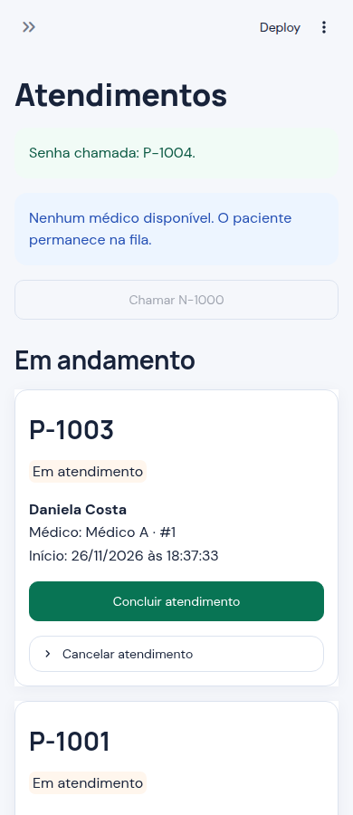

# SIGAE WEB

Aplicação web para simular a triagem e a operação de uma fila de pronto-atendimento. O SIGAE organiza chamadas por risco clínico, distribui pacientes entre médicos disponíveis e mantém o histórico de atendimentos em SQLite.

Use dados fictícios nas demonstrações.

## Executar localmente

Instale Python 3.11 ou superior. Na raiz do projeto, execute os comandos para o seu sistema operacional.

**Linux ou macOS**

```bash
python3 -m venv .venv
.venv/bin/python -m pip install -r requirements.txt
.venv/bin/python -m streamlit run app.py
```

**Windows PowerShell**

```powershell
py -m venv .venv
.\.venv\Scripts\python.exe -m pip install -r requirements.txt
.\.venv\Scripts\python.exe -m streamlit run app.py
```

Abra o endereço informado no terminal, geralmente `http://localhost:8501`. A aplicação usa Streamlit 1.67.0 e SQLite da biblioteca padrão. Uma base nova começa sem pacientes e sem médicos. Para começar, cadastre a equipe em **Médicos** e crie fichas em **Novo paciente**. A tela **Estruturas** permite carregar dados de demonstração enquanto a base estiver sem fichas.

## Funcionalidades

| Tela | O que fazer |
| --- | --- |
| **Visão geral** | Veja a próxima senha e os totais de fichas aguardando, em atendimento, concluídas e canceladas. O botão de chamada atribui a ficha automaticamente. |
| **Novo paciente** | Informe nome, hora de chegada e risco. O sistema gera o número único e exibe a senha. A situação inicial é **Aguardando**. |
| **Pacientes** | Consulte por ID numérico ou pela senha atual. Com o campo vazio, a página lista todas as fichas. |
| **Triagem / Fila** | Veja a fila na ordem clínica. Selecione a ficha para reclassificar ou cancelar um cadastro que ainda aguarda. O cancelamento exige confirmação. |
| **Médicos** | Cadastre o nome e um registro profissional fictício e único. O ID é automático. Consulte pelo seletor e confira a situação e o total de conclusões. |
| **Atendimentos** | Faça uma chamada automática ou acompanhe as fichas ativas pelo paciente, médico e horário de início. Conclua a ficha ou confirme seu cancelamento. |
| **Histórico** | Veja conclusões e cancelamentos em ordem decrescente de encerramento. Filtre por médico, inclusive para ver cancelamentos que aconteceram após uma atribuição. |
| **Chegadas** | Consulte a fila em ordem cronológica de chegada. |
| **Estruturas** | Inspecione a árvore rubro-negra, os dois heaps e os buckets da hash e confira a consistência dos índices. |

Em telas de até 640 px, acesse a navegação pelo botão no canto superior esquerdo. As listas usam cartões para facilitar a leitura no celular. Em telas maiores, usam tabelas. Listas com mais de dez fichas têm seletor de página.

<p>
  
  
  
</p>

## Regras de atendimento

### Ordem da fila

| Risco | Classificação | Senha |
| --- | --- | --- |
| 1 | Emergência | `P-<id>` |
| 2 | Muito urgente | `P-<id>` |
| 3 | Urgente | `P-<id>` |
| 4 | Pouco urgente | `N-<id>` |
| 5 | Não urgente | `N-<id>` |

O menor risco numérico vem primeiro. Em empate, o menor horário de chegada vem primeiro. Persistindo o empate, vale o menor ID. Os prefixos agrupam as senhas para exibição e a fila continua distinguindo os cinco níveis. Uma reclassificação preserva o ID e pode alterar o prefixo. O horário de chegada usa `HH:MM` e representa chegadas de um mesmo dia.

### Distribuição entre médicos

A chamada usa a raiz do heap de pacientes e a raiz do heap de médicos disponíveis. Entre os médicos elegíveis, escolhe quem concluiu menos atendimentos. Em empate, chama quem está há mais tempo sem receber uma ficha. Médicos que nunca receberam ficha precedem os que já receberam. Se o empate persistir, vence o menor ID.

Uma sequência de chamadas registra a ordem das atribuições, inclusive quando duas são feitas no mesmo segundo. Um médico fica ocupado até a conclusão ou o cancelamento da ficha. A conclusão soma um ao contador e o cancelamento preserva o contador. Ambas as ações devolvem o médico ao heap de disponíveis. Com todos ocupados, o botão fica indisponível e a próxima ficha permanece na fila.

## Arquitetura

| Índice em memória | Chave e operações |
| --- | --- |
| **Árvore rubro-negra** | Indexa a espera por `(horário, ID)`. Implementa inserção, remoção, busca, percurso em ordem, rotações e recoloração. A página **Chegadas** usa o percurso. |
| **Min-Heap de pacientes** | Seleciona por `(risco, horário, ID)`. Cadastro insere, triagem reposiciona e chamada ou cancelamento removem. |
| **Min-Heap de médicos** | Guarda apenas disponíveis e seleciona por `(concluídos, última atribuição, ID)`. A chamada extrai a raiz. O encerramento insere de volta com a chave atualizada. |
| **Tabelas hash** | Uma indexa a fila, outra conserva todas as fichas e a terceira localiza médicos. A dispersão usa o resto da divisão pela capacidade. As colisões usam encadeamento separado. Ao ultrapassar 75% de ocupação, a tabela redimensiona para um número primo maior. |

Os dois heaps usam a mesma implementação binária em vetor e instâncias independentes. O dicionário auxiliar do heap mapeia ID para posição, o que permite localizar um elemento para atualização ou remoção sem varrer o vetor. Cada instância mantém a ordem por meio de trocas, subidas e descidas no vetor. Dicionários e conjuntos também apoiam a comparação de invariantes na validação. As consultas de fichas e médicos usam as respectivas tabelas hash.

A árvore, o heap de pacientes e a hash da espera contêm os mesmos IDs aguardando. Ao chamar ou cancelar na fila, esses índices removem a ficha e a hash de fichas preserva seu registro. A validação confere as propriedades da árvore, os dois heaps, as hashes, os vínculos ativos, a carga de cada médico e o histórico.

## Persistência e configuração

A interface cria `sigae.db` na raiz do projeto. As alterações usam SQL escrito diretamente com `sqlite3` e transações de escrita. A leitura reconstrói os índices da aplicação a partir de um único estado do banco. Atribuições registram médico, horário de início e ordem da chamada. Os totais e a disponibilidade são reconstruídos a partir das fichas persistidas. O banco também restringe cada médico a um atendimento ativo e exige que o vínculo aponte para um médico cadastrado.

Bases anteriores são migradas na primeira abertura. Uma base antiga com cinco níveis conserva os valores. Uma base da versão de duas categorias converte **Prioridade** para nível 3 e **Normal** para nível 5, pois a categoria antiga não identifica o nível original. Consultórios antigos que aparecem nas fichas tornam-se médicos fictícios de legado. O início antigo aparece como **Sem registro** e o desempate entre atribuições migradas usa o ID da ficha como ordem inicial. Novas chamadas registram a sequência real.

Use **Atualizar dados** na barra lateral para consultar mudanças de outra sessão. Para isolar dados de demonstração ou verificação, configure um caminho separado com `SIGAE_DB_PATH`.

```bash
SIGAE_DB_PATH=/tmp/sigae-demo.db .venv/bin/python -m streamlit run app.py
```

No PowerShell:

```powershell
$env:SIGAE_DB_PATH = "$env:TEMP\sigae-demo.db"
.\.venv\Scripts\python.exe -m streamlit run app.py
```

## Verificação funcional

Use uma base vazia. Cadastre, nesta ordem, **Médico A**, **Médico B** e **Médico C**, com registros fictícios `FICT-A`, `FICT-B` e `FICT-C`. Cadastre os pacientes na ordem da tabela.

| ID gerado | Nome fictício | Chegada | Risco |
| --- | --- | --- | --- |
| 1000 | Pessoa Normal | 08:00 | 5 |
| 1001 | Pessoa B | 08:15 | 1 |
| 1002 | Pessoa C | 08:15 | 1 |
| 1003 | Pessoa A | 08:10 | 1 |
| 1004 | Pessoa Urgente | 08:05 | 3 |
| 1005 | Pessoa Extra | 08:20 | 4 |

| Ação | Resultado observado |
| --- | --- |
| Faça três chamadas. | `P-1003 → A`, `P-1001 → B`, `P-1002 → C`. A data de início é registrada. O paciente que chegou às 08:10 ganha dos dois de 08:15. Para as fichas das 08:15, vence o menor ID. Entre médicos inicialmente empatados, a ordem é A, B e C. |
| Tente chamar com todos ocupados. | Uma quarta chamada é recusada e as três fichas restantes continuam na fila. |
| Conclua `P-1003`, cancele `P-1001` e chame novamente. | A tem uma conclusão e B tem zero. `P-1004` é atribuído a B. |
| Cancele `P-1002` e `P-1004`, depois chame novamente. | B e C têm zero conclusões e C está há mais tempo sem receber paciente. `N-1005` vai para C, apesar de B ter o menor ID. |
| Reclassifique `N-1000` para nível 2 e chame. | A ficha passa a `P-1000` e vai para B. Ao reabrir a base, os totais de A, B e C são 1, 0 e 0 e o histórico contém uma conclusão e três cancelamentos. |
| Em outra base vazia, carregue **Colisões na hash** em **Estruturas**. Adicione quatro fichas e cancele `N-1000`. | A hash inicia com capacidade 11 e quatro colisões. Após as quatro inserções, alcança capacidade 23. Após a remoção, restam oito fichas e a validação de todos os índices passa. |

## Interface de terminal

Execute `python main.py` para usar a interface em memória. Ela inicia com pacientes e três médicos fictícios e usa uma base independente da aplicação web.

Use **10 · Ver estruturas** para inspecionar os heaps de pacientes e de médicos disponíveis. Na chave dos médicos, a ordem de atribuição `0` indica que o profissional ainda não recebeu uma ficha. Use **12 · Cadastrar médico** para gerar um ID e **13 · Consultar médico** para ver registro, situação, total de conclusões e ficha ativa, quando houver.

## Testes automatizados

Execute `python testes_defesa.py` na raiz do projeto para validar empates no Min-Heap, colisões forçadas na Tabela Hash e bloqueio de entradas inválidas.

Para testar outros cenários, altere as variáveis de entrada ou os valores esperados na seção final do arquivo (`id_esperado_na_raiz`, `colisoes_esperadas` e `horario_para_testar`) e execute novamente.

* **`[PASSOU / FUNCIONANDO CORRETAMENTE]`**: Confirma que o resultado bate com o esperado, valida a integridade das estruturas e exibe a árvore rubro-negra, os níveis do heap, os buckets da hash e os endereços de memória da fonte única de dados.
* **`[FALHOU / NÃO FUNCIONANDO]`**: Aponta a divergência encontrada entre o valor esperado e o retornado pelo sistema, ou indica falha nas propriedades estruturais.